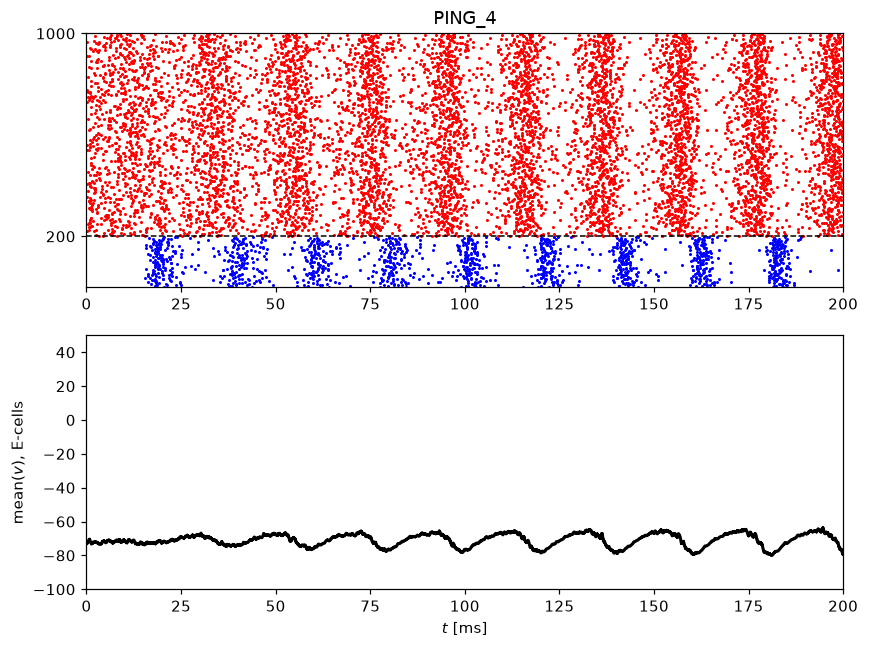
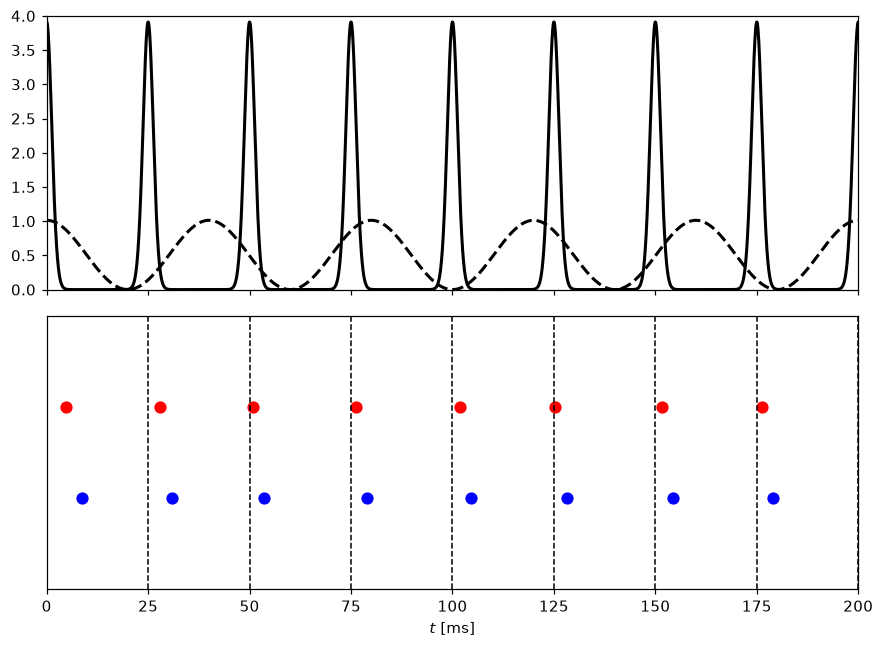
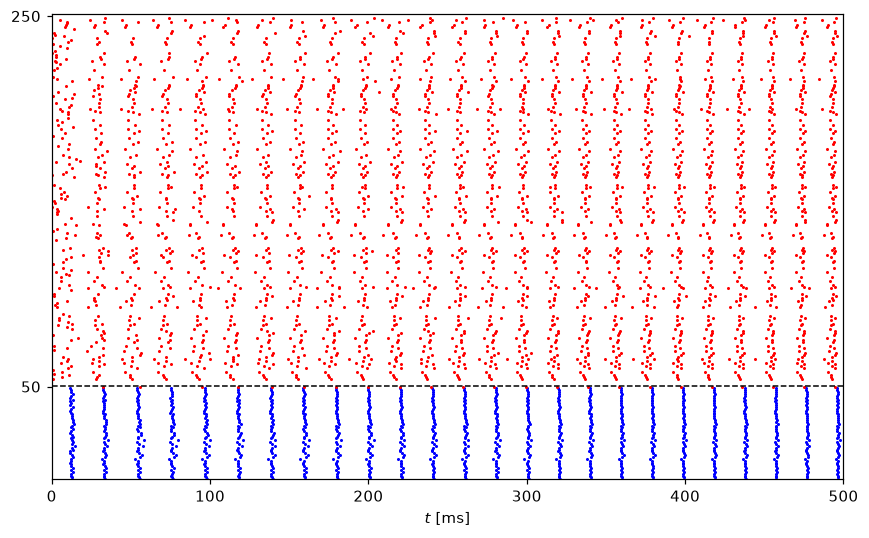

# ModelingNeuralDynamics

Python and Brian2 examples for *An Introduction to Modeling Neuronal Dynamics* by Christoph Börgers.

<table>
  <tr>
    <td width="33%" valign="top"></td>
    <td width="33%" valign="top"></td>
    <td width="33%" valign="top"></td>
  </tr>
</table>

## Installation

```bash
pip install modelingneuraldynamics
```

To run notebooks from a source checkout:

```bash
uv sync --all-groups
uv run jupyter lab
```

See the [Python guide](python/README.md) and [Brian2 setup and coverage guide](brian/README.md) for details. Brian2 notebooks cover representative examples from each chapter.

## Chapters

Open the Python or Brian2 notebooks in Google Colab, or read the chapter guide.
Chapters 2 and 6 have no examples in this repository; chapter 3 is Python only.

| # | Chapter | Python (Colab) | Brian2 (Colab) | Guide |
|---|---|---|---|---|
| 1 | Modeling a Single Neuron | [](https://colab.research.google.com/github/ITNG/ModelingNeuralDynamics/blob/main/python/chapter01.ipynb) | [](https://colab.research.google.com/github/ITNG/ModelingNeuralDynamics/blob/main/brian/chapter01.ipynb) | [Guide](python/chapter01.md) |
| 3 | The Classical HH ODEs | [](https://colab.research.google.com/github/ITNG/ModelingNeuralDynamics/blob/main/python/chapter03.ipynb) | — | [Guide](python/chapter03.md) |
| 4 | Numerical Solution of HH ODEs | [](https://colab.research.google.com/github/ITNG/ModelingNeuralDynamics/blob/main/python/chapter04.ipynb) | [](https://colab.research.google.com/github/ITNG/ModelingNeuralDynamics/blob/main/brian/chapter04.ipynb) | [Guide](python/chapter04.md) |
| 5 | The Simple Model of Neurons in Rodent Brains | [](https://colab.research.google.com/github/ITNG/ModelingNeuralDynamics/blob/main/python/chapter05.ipynb) | [](https://colab.research.google.com/github/ITNG/ModelingNeuralDynamics/blob/main/brian/chapter05.ipynb) | [Guide](python/chapter05.md) |
| 7 | Linear Integrate-and-Fire (LIF) Neurons | [](https://colab.research.google.com/github/ITNG/ModelingNeuralDynamics/blob/main/python/chapter07.ipynb) | [](https://colab.research.google.com/github/ITNG/ModelingNeuralDynamics/blob/main/brian/chapter07.ipynb) | [Guide](python/chapter07.md) |
| 8 | Quadratic Integrate-and-Fire (QIF) and Theta Neurons | [](https://colab.research.google.com/github/ITNG/ModelingNeuralDynamics/blob/main/python/chapter08.ipynb) | [](https://colab.research.google.com/github/ITNG/ModelingNeuralDynamics/blob/main/brian/chapter08.ipynb) | [Guide](python/chapter08.md) |
| 9 | Spike Frequency Adaptation | [](https://colab.research.google.com/github/ITNG/ModelingNeuralDynamics/blob/main/python/chapter09.ipynb) | [](https://colab.research.google.com/github/ITNG/ModelingNeuralDynamics/blob/main/brian/chapter09.ipynb) | [Guide](python/chapter09.md) |
| 10 | The Slow-Fast Phase Plane | [](https://colab.research.google.com/github/ITNG/ModelingNeuralDynamics/blob/main/python/chapter10.ipynb) | [](https://colab.research.google.com/github/ITNG/ModelingNeuralDynamics/blob/main/brian/chapter10.ipynb) | [Guide](python/chapter10.md) |
| 11 | The Saddle-Node Bifurcation | [](https://colab.research.google.com/github/ITNG/ModelingNeuralDynamics/blob/main/python/chapter11.ipynb) | [](https://colab.research.google.com/github/ITNG/ModelingNeuralDynamics/blob/main/brian/chapter11.ipynb) | [Guide](python/chapter11.md) |
| 12 | Two-Dimensional Bifurcation Analysis | [](https://colab.research.google.com/github/ITNG/ModelingNeuralDynamics/blob/main/python/chapter12.ipynb) | [](https://colab.research.google.com/github/ITNG/ModelingNeuralDynamics/blob/main/brian/chapter12.ipynb) | [Guide](python/chapter12.md) |
| 13 | Hopf Bifurcations | [](https://colab.research.google.com/github/ITNG/ModelingNeuralDynamics/blob/main/python/chapter13.ipynb) | [](https://colab.research.google.com/github/ITNG/ModelingNeuralDynamics/blob/main/brian/chapter13.ipynb) | [Guide](python/chapter13.md) |
| 14 | Model Neurons of Bifurcation Type 2 | [](https://colab.research.google.com/github/ITNG/ModelingNeuralDynamics/blob/main/python/chapter14.ipynb) | [](https://colab.research.google.com/github/ITNG/ModelingNeuralDynamics/blob/main/brian/chapter14.ipynb) | [Guide](python/chapter14.md) |
| 15 | Canard Explosions | [](https://colab.research.google.com/github/ITNG/ModelingNeuralDynamics/blob/main/python/chapter15.ipynb) | [](https://colab.research.google.com/github/ITNG/ModelingNeuralDynamics/blob/main/brian/chapter15.ipynb) | [Guide](python/chapter15.md) |
| 16 | Model Neurons of Bifurcation Type 3 | [](https://colab.research.google.com/github/ITNG/ModelingNeuralDynamics/blob/main/python/chapter16.ipynb) | [](https://colab.research.google.com/github/ITNG/ModelingNeuralDynamics/blob/main/brian/chapter16.ipynb) | [Guide](python/chapter16.md) |
| 17 | Frequency-Current Curves | [](https://colab.research.google.com/github/ITNG/ModelingNeuralDynamics/blob/main/python/chapter17.ipynb) | [](https://colab.research.google.com/github/ITNG/ModelingNeuralDynamics/blob/main/brian/chapter17.ipynb) | [Guide](python/chapter17.md) |
| 18 | Bistability Resulting from Rebound Firing | [](https://colab.research.google.com/github/ITNG/ModelingNeuralDynamics/blob/main/python/chapter18.ipynb) | [](https://colab.research.google.com/github/ITNG/ModelingNeuralDynamics/blob/main/brian/chapter18.ipynb) | [Guide](python/chapter18.md) |
| 19 | Bursting | [](https://colab.research.google.com/github/ITNG/ModelingNeuralDynamics/blob/main/python/chapter19.ipynb) | [](https://colab.research.google.com/github/ITNG/ModelingNeuralDynamics/blob/main/brian/chapter19.ipynb) | [Guide](python/chapter19.md) |
| 20 | Chemical Synapses | [](https://colab.research.google.com/github/ITNG/ModelingNeuralDynamics/blob/main/python/chapter20.ipynb) | [](https://colab.research.google.com/github/ITNG/ModelingNeuralDynamics/blob/main/brian/chapter20.ipynb) | [Guide](python/chapter20.md) |
| 21 | Gap Junctions | [](https://colab.research.google.com/github/ITNG/ModelingNeuralDynamics/blob/main/python/chapter21.ipynb) | [](https://colab.research.google.com/github/ITNG/ModelingNeuralDynamics/blob/main/brian/chapter21.ipynb) | [Guide](python/chapter21.md) |
| 22 | A Wilson-Cowan Model of an Oscillatory E-I Network | [](https://colab.research.google.com/github/ITNG/ModelingNeuralDynamics/blob/main/python/chapter22.ipynb) | [](https://colab.research.google.com/github/ITNG/ModelingNeuralDynamics/blob/main/brian/chapter22.ipynb) | [Guide](python/chapter22.md) |
| 23 | Entrainment by Excitatory Input Pulses | [](https://colab.research.google.com/github/ITNG/ModelingNeuralDynamics/blob/main/python/chapter23.ipynb) | [](https://colab.research.google.com/github/ITNG/ModelingNeuralDynamics/blob/main/brian/chapter23.ipynb) | [Guide](python/chapter23.md) |
| 24 | Synchronization by Fast Recurrent Excitation | [](https://colab.research.google.com/github/ITNG/ModelingNeuralDynamics/blob/main/python/chapter24.ipynb) | [](https://colab.research.google.com/github/ITNG/ModelingNeuralDynamics/blob/main/brian/chapter24.ipynb) | [Guide](python/chapter24.md) |
| 25 | Phase Response Curves (PRCs) | [](https://colab.research.google.com/github/ITNG/ModelingNeuralDynamics/blob/main/python/chapter25.ipynb) | [](https://colab.research.google.com/github/ITNG/ModelingNeuralDynamics/blob/main/brian/chapter25.ipynb) | [Guide](python/chapter25.md) |
| 26 | Phase Locking of Two Oscillators | [](https://colab.research.google.com/github/ITNG/ModelingNeuralDynamics/blob/main/python/chapter26.ipynb) | [](https://colab.research.google.com/github/ITNG/ModelingNeuralDynamics/blob/main/brian/chapter26.ipynb) | [Guide](python/chapter26.md) |
| 27 | Phase Locking with Delays | [](https://colab.research.google.com/github/ITNG/ModelingNeuralDynamics/blob/main/python/chapter27.ipynb) | [](https://colab.research.google.com/github/ITNG/ModelingNeuralDynamics/blob/main/brian/chapter27.ipynb) | [Guide](python/chapter27.md) |
| 28 | Weakly Coupled Oscillators | [](https://colab.research.google.com/github/ITNG/ModelingNeuralDynamics/blob/main/python/chapter28.ipynb) | [](https://colab.research.google.com/github/ITNG/ModelingNeuralDynamics/blob/main/brian/chapter28.ipynb) | [Guide](python/chapter28.md) |
| 29 | Stability of the Synchronous State | [](https://colab.research.google.com/github/ITNG/ModelingNeuralDynamics/blob/main/python/chapter29.ipynb) | [](https://colab.research.google.com/github/ITNG/ModelingNeuralDynamics/blob/main/brian/chapter29.ipynb) | [Guide](python/chapter29.md) |
| 30 | The PING Model of Gamma Rhythms | [](https://colab.research.google.com/github/ITNG/ModelingNeuralDynamics/blob/main/python/chapter30.ipynb) | [](https://colab.research.google.com/github/ITNG/ModelingNeuralDynamics/blob/main/brian/chapter30/PING_2_cell_with_s_and_q.ipynb)<br>[More examples](brian/README.md#coverage) | [Guide](python/chapter30.md) |
| 31 | ING Rhythms | [](https://colab.research.google.com/github/ITNG/ModelingNeuralDynamics/blob/main/python/chapter31.ipynb) | [](https://colab.research.google.com/github/ITNG/ModelingNeuralDynamics/blob/main/brian/chapter31.ipynb) | [Guide](python/chapter31.md) |
| 32 | M-Current PING and Poisson PING | [](https://colab.research.google.com/github/ITNG/ModelingNeuralDynamics/blob/main/python/chapter32.ipynb) | [](https://colab.research.google.com/github/ITNG/ModelingNeuralDynamics/blob/main/brian/chapter32.ipynb) | [Guide](python/chapter32.md) |
| 33 | M-Current PING and PINB | [](https://colab.research.google.com/github/ITNG/ModelingNeuralDynamics/blob/main/python/chapter33.ipynb) | [](https://colab.research.google.com/github/ITNG/ModelingNeuralDynamics/blob/main/brian/chapter33.ipynb) | [Guide](python/chapter33.md) |
| 34 | Nested Gamma-Theta Rhythms | [](https://colab.research.google.com/github/ITNG/ModelingNeuralDynamics/blob/main/python/chapter34.ipynb) | [](https://colab.research.google.com/github/ITNG/ModelingNeuralDynamics/blob/main/brian/chapter34.ipynb) | [Guide](python/chapter34.md) |
| 35 | Periodic Inhibition | [](https://colab.research.google.com/github/ITNG/ModelingNeuralDynamics/blob/main/python/chapter35.ipynb) | [](https://colab.research.google.com/github/ITNG/ModelingNeuralDynamics/blob/main/brian/chapter35.ipynb) | [Guide](python/chapter35.md) |
| 36 | F-I Curves: Pulsed Excitation | [](https://colab.research.google.com/github/ITNG/ModelingNeuralDynamics/blob/main/python/chapter36.ipynb) | [](https://colab.research.google.com/github/ITNG/ModelingNeuralDynamics/blob/main/brian/chapter36.ipynb) | [Guide](python/chapter36.md) |
| 37 | Thresholding in PING | [](https://colab.research.google.com/github/ITNG/ModelingNeuralDynamics/blob/main/python/chapter37.ipynb) | [](https://colab.research.google.com/github/ITNG/ModelingNeuralDynamics/blob/main/brian/chapter37.ipynb) | [Guide](python/chapter37.md) |
| 38 | Gamma Coherence | [](https://colab.research.google.com/github/ITNG/ModelingNeuralDynamics/blob/main/python/chapter38.ipynb) | [](https://colab.research.google.com/github/ITNG/ModelingNeuralDynamics/blob/main/brian/chapter38.ipynb) | [Guide](python/chapter38.md) |
| 39 | Short-Term Depression and Facilitation | [](https://colab.research.google.com/github/ITNG/ModelingNeuralDynamics/blob/main/python/chapter39.ipynb) | [](https://colab.research.google.com/github/ITNG/ModelingNeuralDynamics/blob/main/brian/chapter39.ipynb) | [Guide](python/chapter39.md) |
| 40 | Spike-Timing-Dependent Plasticity (STDP) | [](https://colab.research.google.com/github/ITNG/ModelingNeuralDynamics/blob/main/python/chapter40.ipynb) | [](https://colab.research.google.com/github/ITNG/ModelingNeuralDynamics/blob/main/brian/chapter40.ipynb) | [Guide](python/chapter40.md) |

[Book and original MATLAB code](https://link.springer.com/book/10.1007/978-3-319-51171-9) · [License](LICENSE)
